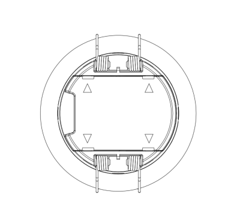
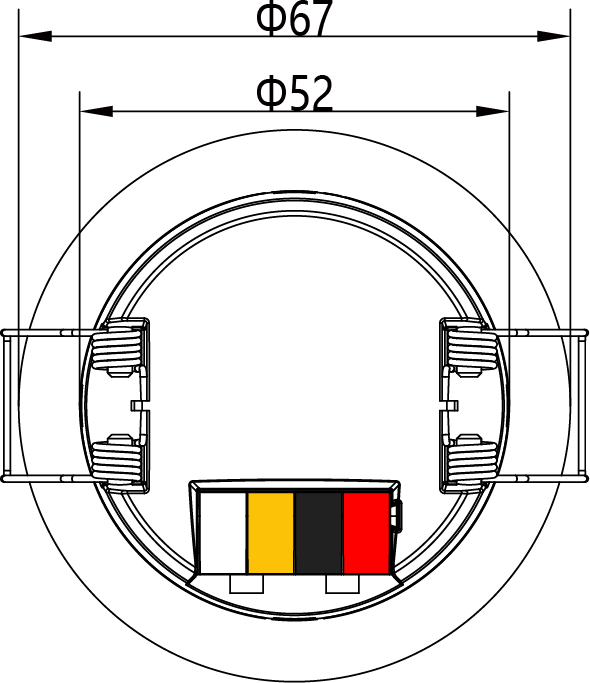
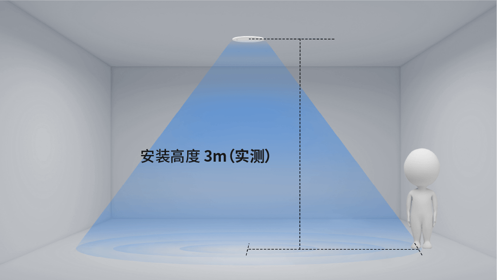
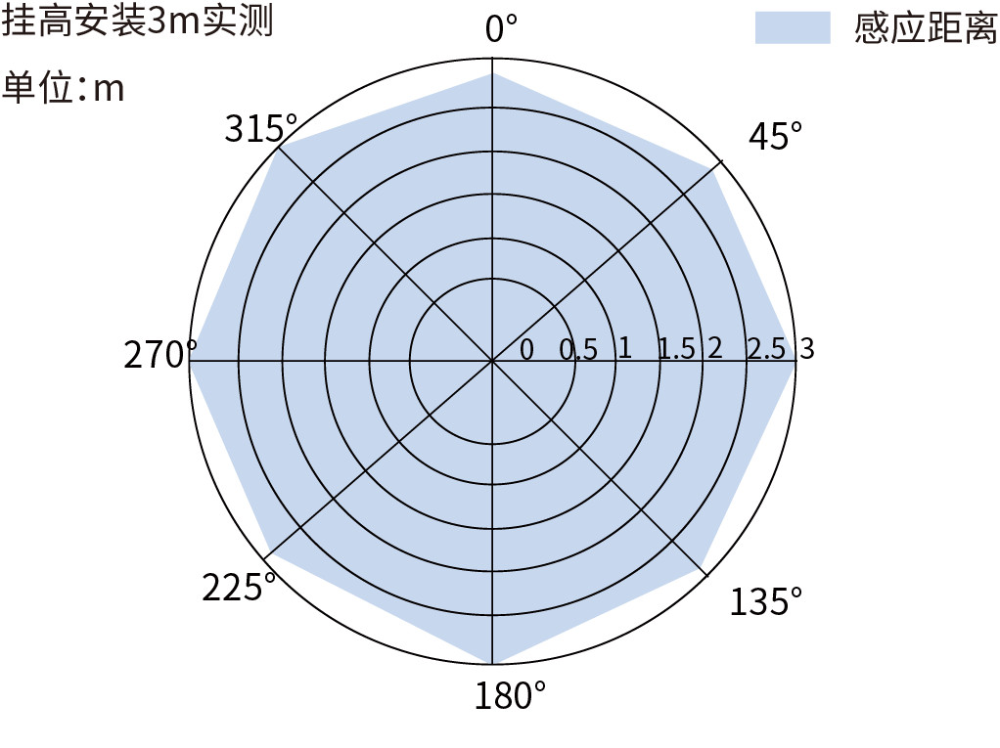

# EDV25P-4 规格书

> EDV25P-4（RS485 / Modbus 版）规格书在线版，整理自《EDV25P 系列规格书》V1.0.0-20260915

:::info PDF 下载
- [📄 EDV25P 系列规格书（V1.0.0，2026-09-15，中英对照）](../assets/EDV25P%E7%B3%BB%E5%88%97%E8%A7%84%E6%A0%BC%E4%B9%A6-V1.0.0-20260915.pdf)
:::

## 产品特征

- **跌倒检测**：检测区域内人员跌倒事件实时识别，区分正常/疑似/确认三级状态，可联动告警与灯光
- **存在检测**：静止人体亦可检测，存在检测半径最大 3 米，人员离开后按设定延时自动上报无人
- **光照联动**：内置数字光照传感器，检测范围 0-65535 Lux，支持照度高/低场景联动控制灯光
- **通讯方式丰富**：支持 RS485 总线接入，可通过蓝牙小程序进行参数配置与调试
- **易安装部署**：嵌入式吸顶安装，标准开孔 Φ55mm，施工便捷

## 应用场景

- **智慧养老**：常安装于卧室、卫生间等区域，实时监测跌倒事件并联动告警，守护独居老人安全
- **智能家居**：与照明灯具联动，实现有人灯亮、无人灯灭及光照联动控制，节能省心
- **医院病房**：安装于病房及卫生间区域，病患跌倒即时告警，减轻护理压力

## 外形结构

### 正面视图与背面视图

*图 1.1：正面视图*

*图 1.2：背面视图*

### 外形尺寸

*图 1.3：外形尺寸（单位 mm）*

*图 1.3：外形尺寸——俯视方向（单位 mm）*

*图 1.3：外形尺寸——底面方向（单位 mm）*

:::note 备注
整机尺寸公差 ±0.2mm，详细尺寸以三视图标注为准。图 1.3 底面视图中可见 4 位接线端子（对应 V/G/A/B），端子丝印方向以实物为准（图待核对）。
:::

### 接口说明

*图 1.4：EDV25P-4 接口分布图*

表 1.1：EDV25P-4 接口功能表

| 接口序号 | 名称 | 功能 |
|---------|------|------|
| 1 | V | DC 12-30V 电源输入正极 |
| 2 | G | 电源负极 / GND |
| 3 | A | RS485-A |
| 4 | B | RS485-B |

:::note 备注
图 1.4 为底面方向视图，图中端子丝印呈镜像显示为 B-A-G-V；实际接线以接口功能表和产品实物丝印为准（图待核对）。
:::

### 按键说明

*图 1.7：按键分布图*

表 1.4：按键功能表

| 接口序号 | 名称 | 功能 |
|---------|------|------|
| 1 | Set/Reset | 配网/复位共用按钮 |

长按 10 秒恢复出厂设置。

## 电气参数

| 项目 | 数值 | 说明 |
|------|------|------|
| 工作电压 | 4/K：DC 12-30V | 4/K 直流供电，T 交流供电 |
| 峰值电流 | 317 mA | 12V 供电 |
| 平均电流 | 124 mA | 12V 供电 |
| 整机功耗 | ＜5 W | AC 220V（KNX＜2W） |

## 功能参数

表 1.5：参数表

| 类别 | 参数 | 可配置 | 数值 | 单位 | 说明 |
|------|------|-------|------|------|------|
| 雷达参数 | 工作频段 | N | 57.5-61.3 | GHz | 中值 60GHz |
| 雷达参数 | 发射功率 | Y | 12/14/15/16 | dBm | 可配置 |
| 雷达参数 | 调制方式 | N | FMCW | - | 调频连续波 |
| 雷达参数 | 3dB 波束角 | N | 60 | ◦ | 波束宽度 |
| 性能参数 | 存在检测半径 | Y | 3 Max | m | 最大存在检测半径 |
| 性能参数 | 跌倒检测半径 | Y | 3 Max | m | 最大跌倒检测半径 |
| 性能参数 | 推荐安装高度 | Y | 2.5-3.5 | m | 默认 3.0m，可配置 |
| 性能参数 | 运动灵敏度 | Y | 1-10 | - | 默认 10 |
| 性能参数 | 存在灵敏度 | Y | 1-10 | - | 默认 10 |
| 性能参数 | 延时时间 | Y | 1-65535 | s | 默认 30s |
| 性能参数 | 检测区域 | Y | 可配置 | mm | X/Y：±3000；Z：0-3500 |
| 性能参数 | 光照检测范围 | Y | 0-65535 | Lux | 数字光照传感器 |
| 性能参数 | 状态上报周期 | Y | 500-65535 | ms | 雷达上报周期 |
| 电气参数 | 工作电压 | N | 4/K：DC 12-30V；T：AC 90-277V | V | 4/K 直流供电，T 交流供电 |
| 电气参数 | 峰值电流 | N | 317 | mA | 12V 供电 |
| 电气参数 | 平均电流 | N | 124 | mA | 12V 供电 |
| 电气参数 | 整机功耗 | N | ＜5 | W | AC 220V（KNX＜2W） |
| 物理参数 | 外形尺寸 | N | - | mm | 详见三视图标注 |
| 物理参数 | 重量 | N | - | g | - |
| 物理参数 | 外壳材质 | N | PC | - | 聚碳酸酯 |
| 物理参数 | 安装方式 | N | 吸顶 | - | 嵌入式安装 |
| 物理参数 | 安装孔径 | N | 55 | mm | 标准开孔直径 |
| 环境适应性 | 工作温度 | N | -20-+85 | ℃ | 正常工作环境温度 |
| 环境适应性 | 储存温度 | N | -20-+85 | ℃ | 存储环境温度 |

:::note 备注
1. “可配置？”指的是是否提供接口供用户根据需要对该参数在允许范围内进行配置。
2. 以下情况**不**定义为跌倒事件：① 坐倒（指坐在地上跌倒）不定义为跌倒；② 靠坐（人没有完全倒下去）不定义为跌倒；③ 蹲姿跌倒不定义为跌倒。
:::

## 性能曲线

### 安装方向与检测分区示意

*图 1.8：安装方向与检测分区示意*

### 挂高角度性能

*图 1.9：挂高角度性能*

### 感应性能

*图 1.10：感应性能*

:::note 备注
在室内环境（5m×5m）、安装高度 3m、X/Y 坐标范围 ±300cm 条件下测得感应性能曲线。以上性能曲线仅供参考，具体以实际产品实测为准。
:::

## 通信协议

EDV25P-4 支持以下通信方式：

- **RS485 总线**：标准 Modbus 类总线协议，支持多设备组网、轮询读写状态与参数；上位机/PLC/网关为主站，设备为从站
- **蓝牙 BLE**：私有蓝牙透传协议，供小程序配对、参数配置、实时数据查看
- **UART 串口**：本地调试、数据透传（BLE 与 UART 为三版本通用接口）

RS485 总线的寄存器定义、功能码与主站访问流程见 [Modbus RTU 协议说明](./modbus-protocol)。

## 命名规范

命名规则：制造商（ED）+ 频段（V=60GHz）+ 大类别（2=独立传感器）+ 子类别（5=通用）+ 扩展功能（Y=有光敏）+ 流水号。

## 注意事项

### 安全合规

1. 本产品符合室内智能传感设备安规标准，仅适用于室内环境使用
2. 电气接线严格遵循国标电气规范，非专业人员禁止拆机、改线
3. 设备防护等级 IP67，仅适用于常规室内防潮环境，禁止长期浸泡、户外淋雨使用

### 免责声明

1. 因用户私自拆机、改装接线、违规供电造成的设备损坏、安全事故，本公司不承担保修及相关责任
2. 未按照安装规范（间距、远离干扰源、避开金属区域）安装，导致设备误触发、检测异常，不在免费维保范围内
3. 自然灾害、人为磕碰、外力损坏、进水进尘造成的故障，不予免费保修
4. 产品固件、规格会持续迭代优化，更新版本不再单独通知，如需最新资料请联系销售人员
5. 测试参数为实验室标准环境数据，实际使用效果因现场环境、安装方式存在差异，不属于产品质量问题

### 售后服务

1. **质保服务**：产品按照行业标准提供质保，质保期内非人为质量问题可享受维修、更换服务
2. **技术支持**：安装调试、参数配置、协议对接问题，可联系我司销售或 FAE 工程师提供技术支持
3. **定制服务**：个性化功能、参数、接口定制，可对接商务团队评估方案与工期
4. **资料获取**：最新版规格书、协议文档、固件程序，请联系官方工作人员索取

## 历史修订记录

| 版本 | 日期 | 编制 | 变更说明 |
|------|------|------|---------|
| V1.0.0 | 2026-08-20 | 研发部 | 初版发布 |

## 适用范围说明

本页为 **EDV25P-4（RS485 / Modbus 版）** 变体的在线规格书，内容取自《EDV25P 系列规格书》V1.0.0（2026-09-15）中适用于本变体的部分。三版本差异（供电方式与通讯协议）见[变体概览](./index.md)；系列内 KNX（EDV25P-K）与涂鸦 Zigbee（EDV25P-T）版本请参见对应变体文档。
