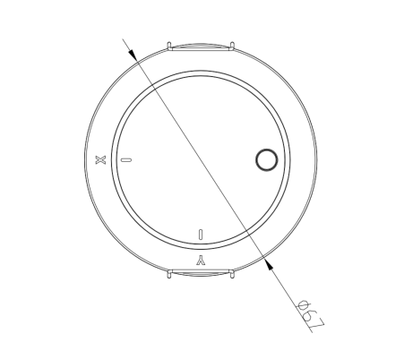
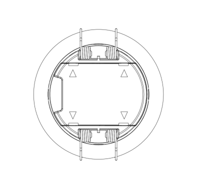
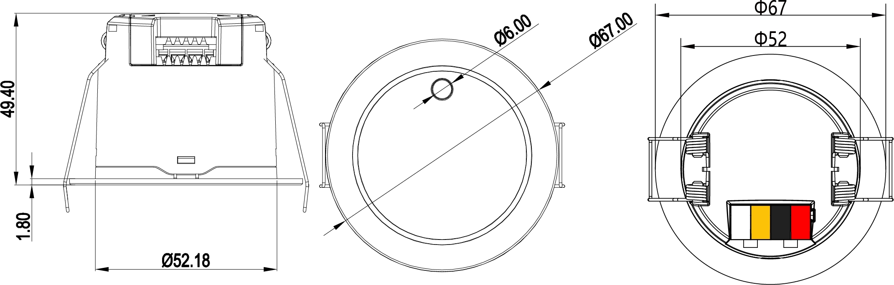
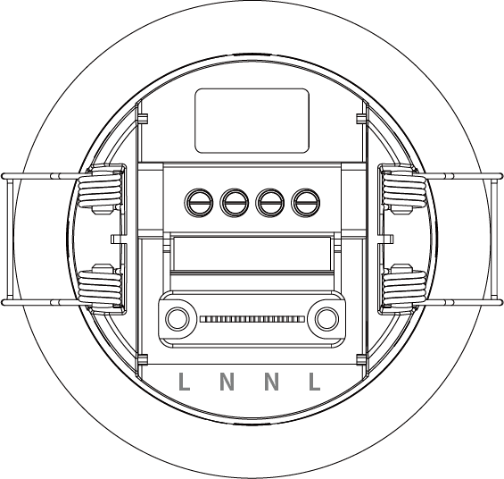
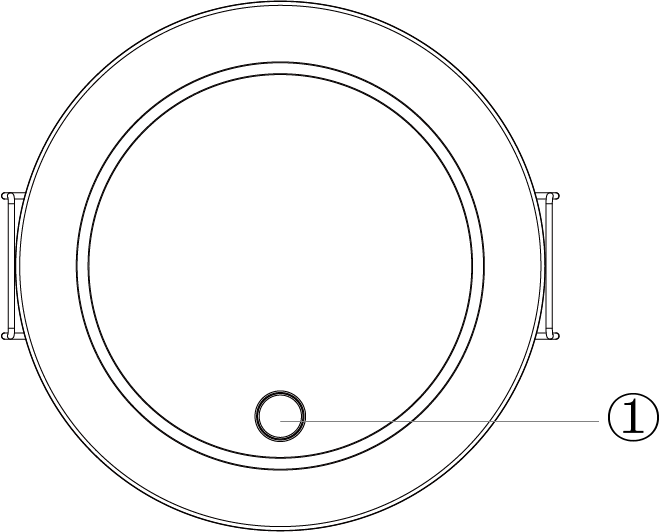
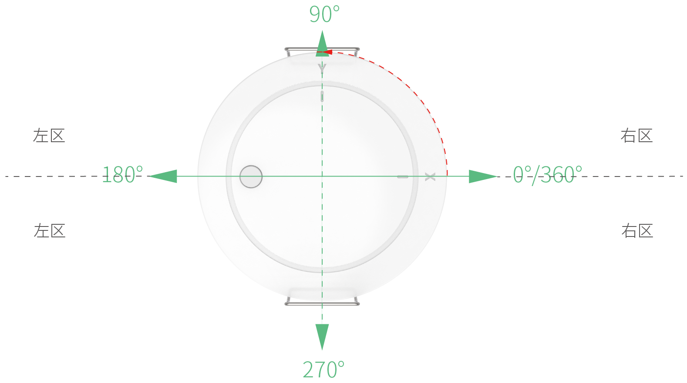
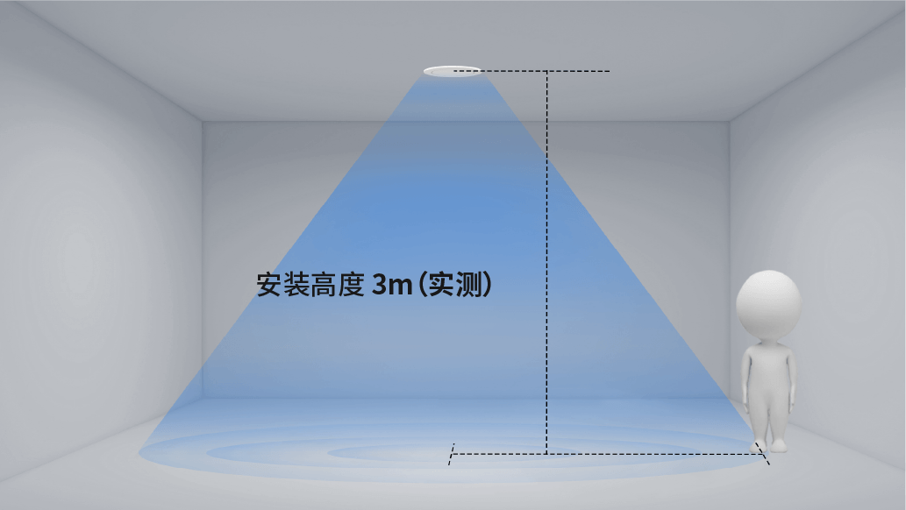
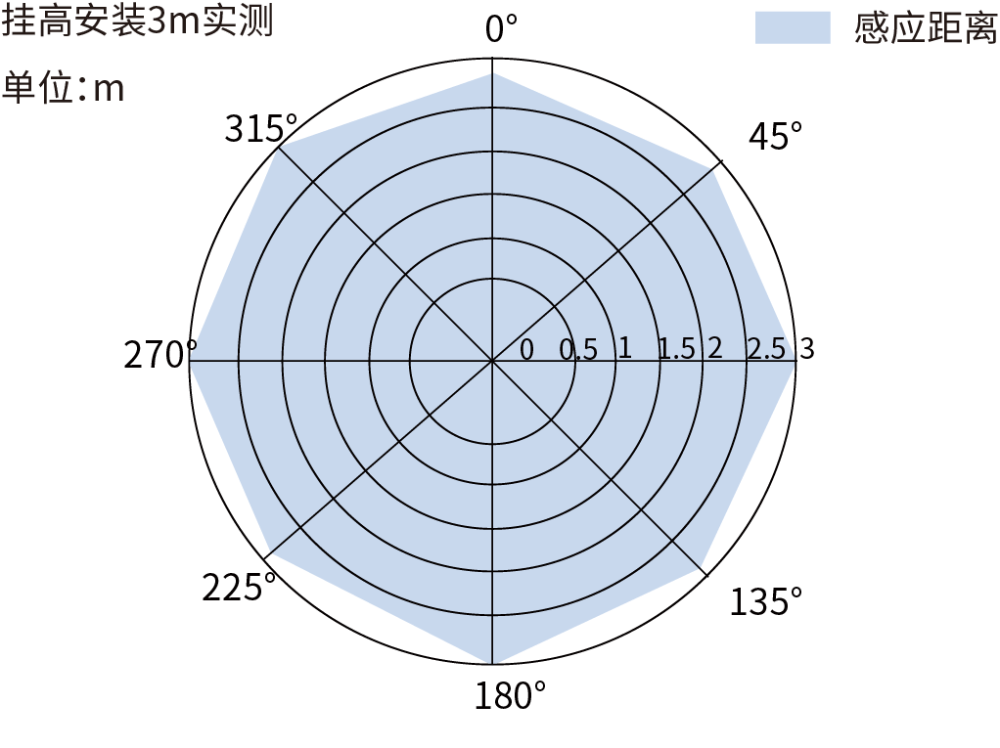

# EDV25P-T 规格书

> EDV25P-T（涂鸦 Zigbee 版）规格书在线版，整理自《EDV25P 系列规格书》V1.0.0（2026-09-15）

:::info PDF 下载
- [📄 EDV25P 系列规格书（V1.0.0，2026-09-15，中英对照）](../assets/EDV25P%E7%B3%BB%E5%88%97%E8%A7%84%E6%A0%BC%E4%B9%A6-V1.0.0-20260915.pdf)
:::

## 产品特征

- **跌倒检测**：检测区域内人员跌倒事件实时识别，区分正常/疑似/确认三级状态，可联动告警与灯光
- **存在检测**：静止人体亦可检测，存在检测半径最大 3 米，人员离开后按设定延时自动上报无人
- **光照联动**：内置数字光照传感器（检测范围 0-65535 Lux），与 60GHz 毫米波雷达共同构成「可见光 + 毫米波」感应方式，支持照度高/低场景联动控制灯光
- **涂鸦 Zigbee 接入**：标准涂鸦 Zigbee 通讯协议，支持涂鸦 APP 配网、状态查看与参数配置，定位「涂鸦 APP 联动」
- **AC 市电供电**：AC 90-277V 宽压输入，为 EDV25P 系列中唯一采用交流市电供电的版本
- **易安装部署**：嵌入式吸顶安装，标准开孔 Φ55mm，施工便捷
- **隐私保护**：无图像采集，适用于卧室、卫生间、医院病房、养老院等隐私敏感场景

## 应用场景

- **智慧养老**：常安装于卧室、卫生间等区域，实时监测跌倒事件并联动告警，守护独居老人安全
- **智能家居**：与照明灯具联动，实现有人灯亮、无人灯灭及光照联动控制，节能省心
- **医院病房**：安装于病房及卫生间区域，病患跌倒即时告警，减轻护理压力

## 外形结构

### 正面视图与背面视图

*图 1.1：正面视图*

*图 1.2：背面视图*

### 外形尺寸

*图 1.3：外形尺寸三视图（单位 mm；按原文档自左至右顺序排列）*

:::note 备注
1. 整机尺寸公差 ±0.2mm，详细尺寸以三视图标注为准。
2. 规格书图 1.3 由三个视图组成且未分别标注视图方向，本页按原文档自左至右顺序合并为本栏目的一张图片；各视图的朝向与端子丝印方向以《EDV25P 使用说明书》及产品实物为准（图待核对）。
:::

### 接口说明

*图 1.6：EDV25P-T 接口分布图*

表 1.3：EDV25P-T 接口功能表

| 接口序号 | 名称 | 功能 |
|---------|------|------|
| 1 | L | 火线端口（AC 90-277V） |
| 2 | N | 零线端口 |

:::note 备注
1. EDV25P-T 为系列中唯一采用交流市电供电的版本，接线必须在断电状态下由专业人员按国标电气规范操作。
2. 图 1.6 中四个端子位依次标注为 L-N-N-L（左右各一组 L/N），规格书表 1.3 仅列出 L（火线端口，AC 90-277V）与 N（零线端口）两项；供电时接入单火（L）单零（N）即可，各端子是否互为连通、能否手拉手布线为其他设备供电，请以《EDV25P 使用说明书》与产品实物丝印为准（图待核对）。
:::

### 按键说明

*图 1.7：按键分布图*

表 1.4：按键功能表

| 接口序号 | 名称 | 功能 |
|---------|------|------|
| 1 | Set/Reset | 配网/复位共用按钮 |

Set/Reset 为配网与复位共用按钮，长按 10 秒恢复出厂设置；涂鸦版本执行恢复出厂设置时**保留软件场景绑定**。

## 电气参数

| 项目 | 数值 | 说明 |
|------|------|------|
| 工作电压 | AC 90-277V | 本变体交流市电供电（系列内 EDV25P-4 / EDV25P-K 为 DC 12-30V） |
| 整机功耗 | ＜5 W | AC 220V 条件下测得 |

:::note 备注
1. 系列规格书参数表中的「峰值电流 317 mA」「平均电流 124 mA」为 DC 12V 供电条件下的测试值（对应 EDV25P-4 / EDV25P-K），不适用于本交流供电版本，故未列入上表。
2. 参数表中整机功耗一栏原始记录为「＜5 W，AC 220V（KNX＜2W）」，其中「KNX＜2W」为 EDV25P-K 版本的备注。
:::

## 功能参数

表 1.5：参数表

| 类别 | 参数 | 可配置 | 数值 | 单位 | 说明 |
|------|------|-------|------|------|------|
| 雷达参数 | 工作频段 | N | 57.5-61.3 | GHz | 中值 60GHz |
| 雷达参数 | 发射功率 | Y | 12/14/15/16 | dBm | 可配置 |
| 雷达参数 | 调制方式 | N | FMCW | - | 调频连续波 |
| 雷达参数 | 3dB 波束角 | N | 60 | ° | 波束宽度 |
| 性能参数 | 存在检测半径 | Y | 3 Max | m | 最大存在检测半径 |
| 性能参数 | 跌倒检测半径 | Y | 3 Max | m | 最大跌倒检测半径 |
| 性能参数 | 推荐安装高度 | Y | 2.5-3.5 | m | 默认 3.0m，可配置 |
| 性能参数 | 运动灵敏度 | Y | 1-10 | - | 默认 10 |
| 性能参数 | 存在灵敏度 | Y | 1-10 | - | 默认 10 |
| 性能参数 | 延时时间 | Y | 1-65535 | s | 默认 30s |
| 性能参数 | 检测区域 | Y | 可配置 | mm | X/Y：±3000；Z：0-3500 |
| 性能参数 | 光照检测范围 | Y | 0-65535 | Lux | 数字光照传感器 |
| 性能参数 | 状态上报周期 | Y | 500-65535 | ms | 雷达上报周期 |
| 电气参数 | 工作电压 | N | T：AC 90-277V | V | 4/K 直流供电，T 交流供电 |
| 电气参数 | 峰值电流 | N | 317 | mA | 12V 供电 |
| 电气参数 | 平均电流 | N | 124 | mA | 12V 供电 |
| 电气参数 | 整机功耗 | N | ＜5 | W | AC 220V（KNX＜2W） |
| 物理参数 | 外形尺寸 | N | - | mm | 详见三视图标注 |
| 物理参数 | 重量 | N | - | g | - |
| 物理参数 | 外壳材质 | N | PC | - | 聚碳酸酯 |
| 物理参数 | 安装方式 | N | 吸顶 | - | 嵌入式安装 |
| 物理参数 | 安装孔径 | N | 55 | mm | 标准开孔直径 |
| 环境适应性 | 工作温度 | N | -20-+85 | ℃ | 正常工作环境温度 |
| 环境适应性 | 储存温度 | N | -20-+85 | ℃ | 存储环境温度 |

:::note 备注
1. 「可配置？」指的是是否提供接口供用户根据需要对该参数在允许范围内进行配置。
2. 上表中工作频段、发射功率、调制方式、3dB 波束角、存在/跌倒检测半径、推荐安装高度、灵敏度、延时时间、检测区域、光照检测范围、状态上报周期、外壳材质、安装方式、安装孔径、工作与储存温度等均为三版本通用参数，在 EDV25P-T 上同样适用。
3. 以下情况**不**定义为跌倒事件：① 坐倒（指坐在地上跌倒）不定义为跌倒；② 靠坐（人没有完全倒下去）不定义为跌倒；③ 蹲姿跌倒不定义为跌倒。
:::

## 功能说明

### 跌倒检测三级判定

设备在检测区域内实时识别人员跌倒事件，输出**正常 / 疑似 / 确认**三级状态，可联动告警与灯光；坐倒、靠坐、蹲姿跌倒不计为跌倒事件（见上表备注 3）。

### 光照联动

内置数字光照传感器（检测范围 0-65535 Lux），可结合环境照度高/低与有人/无人状态联动控制灯光。

### 检测区域与安装高度

检测区域（X/Y：±3000mm，Z：0-3500mm）与推荐安装高度（2.5-3.5m，默认 3.0m）均为可配置参数，设备按设定边界进行存在检测与跌倒判定。

### 隐私保护

产品无图像采集，从根源保护用户隐私，适用于卧室、卫生间、医院病房、养老院等隐私敏感场景。

## 性能曲线

### 安装方向与检测分区示意

*图 1.8：安装方向与检测分区示意*

### 挂高角度性能

*图 1.9：挂高角度性能*

### 感应性能

*图 1.10：感应性能*

:::note 备注
在室内环境（5m×5m）、安装高度 3m、X/Y 坐标范围 ±300cm 条件下测得感应性能曲线。以上性能曲线仅供参考，具体以实际产品实测为准。
:::

## 通信与配网

EDV25P-T 支持以下通信方式：

- **涂鸦 Zigbee**：标准涂鸦 Zigbee 通讯协议，支持涂鸦 APP 配网、状态查看与参数配置，定位「涂鸦 APP 联动」
- **蓝牙 BLE**：私有蓝牙透传协议，供小程序配对、参数配置、实时数据查看
- **UART 串口**：本地调试、数据透传（BLE 与 UART 为三版本通用接口）

:::note 说明
本页不涉及 MQTT 协议：EDV25P-T 通过涂鸦 Zigbee 接入涂鸦生态，不使用 MQTT 上云协议。涂鸦 Zigbee 数据模型（DP 点定义）与配网流程整理后将在本栏目发布。
:::

## 注意事项

### 安全合规

1. 本产品符合室内智能传感设备安规标准，仅适用于室内环境使用
2. 电气接线严格遵循国标电气规范，非专业人员禁止拆机、改线
3. 设备防护等级 IP67，仅适用于常规室内防潮环境，禁止长期浸泡、户外淋雨使用

### 免责声明

1. 因用户私自拆机、改装接线、违规供电造成的设备损坏、安全事故，本公司不承担保修及相关责任
2. 未按照安装规范（间距、远离干扰源、避开金属区域）安装，导致设备误触发、检测异常，不在免费维保范围内
3. 自然灾害、人为磕碰、外力损坏、进水进尘造成的故障，不予免费保修
4. 产品固件、规格会持续迭代优化，更新版本不再单独通知，如需最新资料请联系销售人员
5. 测试参数为实验室标准环境数据，实际使用效果因现场环境、安装方式存在差异，不属于产品质量问题

### 售后服务

1. **质保服务**：产品按照行业标准提供质保，质保期内非人为质量问题可享受维修、更换服务
2. **技术支持**：安装调试、参数配置、协议对接问题，可联系我司销售或 FAE 工程师提供技术支持
3. **定制服务**：个性化功能、参数、接口定制，可对接商务团队评估方案与工期
4. **资料获取**：最新版规格书、协议文档、固件程序，请联系官方工作人员索取

## 历史修订记录

| 版本 | 日期 | 编制 | 变更说明 |
|------|------|------|---------|
| V1.0.0 | 2026-08-20 | 研发部 | 初版发布 |

:::note 版本日期说明
《EDV25P 系列规格书》封面及文件名标注版本日期为 2026-09-15，正文「版本记录」页标注编制日期为 2026-08-20，两处不一致；本表沿用原文档「版本记录」页的日期，以官方最新发布版本为准。
:::

## 适用范围说明

本页为 **EDV25P-T（涂鸦 Zigbee 版）** 变体的在线规格书，内容取自《EDV25P 系列规格书》V1.0.0（2026-09-15）中适用于本变体的部分。三版本差异（供电方式与通讯协议）见[变体概览](./index.md)；系列内 RS485（EDV25P-4）与 KNX（EDV25P-K）版本请参见对应变体文档。
