# EDV25P 使用说明

> EDV25P 系列（-4 / -K / -T）使用说明在线版，整理自《EDV25P 系列产品使用说明书》V1.0.0（2026-09-15），适用于全部三个型号

:::info PDF 下载
本页为在线阅读版（中文）；完整中英对照版请 [📄 下载 PDF 使用说明书（V1.0.0）](./assets/EDV25P%E4%BD%BF%E7%94%A8%E8%AF%B4%E6%98%8E%E4%B9%A6-V1.0.0-20260915.pdf)。
:::

## 1 产品介绍

### 1.1 产品概述

EDV25P 系列产品，工作频段为 57.5-61.3GHz，主要面向跌倒检测与人体存在监测应用。单台设备可实现最大 3 米半径的人体存在检测与 3 米半径的跌倒检测，推荐安装高度 2.5-3.5 米。产品使用毫米波 FMCW 探测技术，实时识别有人/无人状态与跌倒事件（正常/疑似/确认三级），并内置数字光照传感器，支持光照联动控制。产品无图像采集，从根源保护用户隐私，适用于卧室、卫生间、医院病房、养老院等隐私敏感场景。

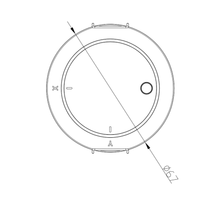

### 1.2 产品特点

- **跌倒检测**：检测区域内人员跌倒事件实时识别，区分正常/疑似/确认三级状态，可联动告警与灯光
- **存在检测**：静止人体亦可检测，存在检测半径最大 3 米，人员离开后按设定延时自动上报无人
- **光照联动**：内置数字光照传感器，检测范围 0-65535 Lux，支持照度高/低场景联动控制灯光
- **通讯方式丰富**：支持 RS485 总线、KNX 总线及涂鸦 Zigbee 接入，可通过蓝牙小程序进行参数配置与调试
- **易安装部署**：嵌入式吸顶安装，标准开孔 Φ55mm，施工便捷

### 1.3 应用场景

- **智慧养老**：常安装于卧室、卫生间等区域，实时监测跌倒事件并联动告警，守护独居老人安全
- **智能家居**：与照明灯具联动，实现有人灯亮、无人灯灭及光照联动控制，节能省心
- **医院病房**：安装于病房及卫生间区域，病患跌倒即时告警，减轻护理压力

### 1.4 外形结构

#### 外形尺寸

全系列通用安装开孔：标准 Φ55mm，产品整体尺寸公差 ±0.2mm，详细尺寸以三视图标注为准。

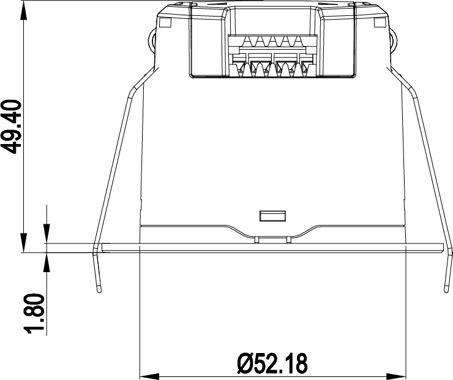

:::note
以上三张为说明书图 1.3（单位：mm）的三视图。第二、三张视图的正式视图方向（俯视/仰视）以源 PDF 与结构图纸为准，此处沿用说明书原图注并按顺序排列，图注方向待产品确认。
:::

#### 接口说明

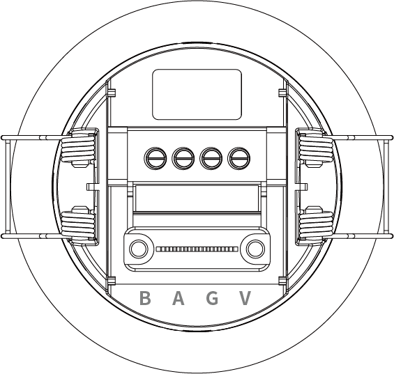

| 接口序号 | 名称 | 功能 |
|---------|------|------|
| 1 | V | DC 12-30V 电源输入正极 |
| 2 | G | 电源负极 / GND |
| 3 | A | RS485-A |
| 4 | B | RS485-B |

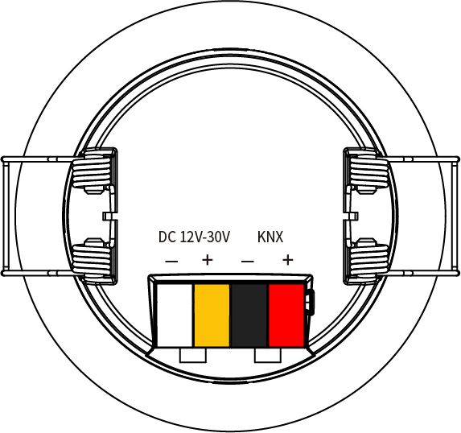

| 接口序号 | 名称 | 功能 |
|---------|------|------|
| 1 | VCC | DC 12-30V 电源输入正极 |
| 2 | GND | 电源负极 / GND |
| 3 | KNX+（红） | KNX 总线正极 |
| 4 | KNX-（黑） | KNX 总线负极 |

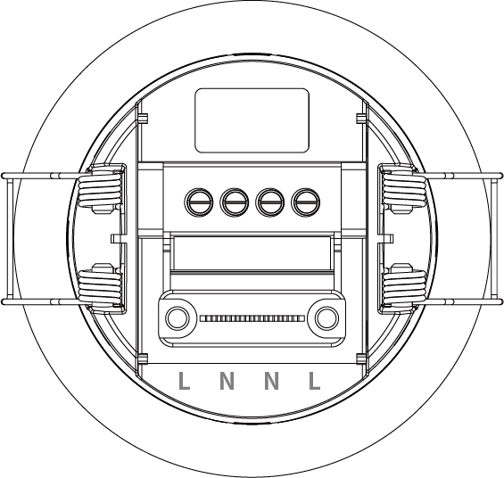

| 接口序号 | 名称 | 功能 |
|---------|------|------|
| 1 | L | 火线端口（AC 90-277V） |
| 2 | N | 零线端口 |

| 接口序号 | 名称 | 功能 |
|---------|------|------|
| ① | Set/Reset | 配网/复位共用按钮 |

### 1.5 性能参数

#### 参数列表

| 类别 | 参数 | 可配置 | 数值 | 单位 | 说明 |
|------|------|--------|------|------|------|
| 雷达参数 | 工作频段 | N | 57.5-61.3 | GHz | 中值 60GHz |
| 雷达参数 | 发射功率 | Y | 12/14/15/16 | dBm | 可配置 |
| 雷达参数 | 调制方式 | N | FMCW | - | 调频连续波 |
| 雷达参数 | 3dB 波束角 | N | 60 | ° | 波束宽度 |
| 性能参数 | 存在检测半径 | Y | 3 Max | m | 最大存在检测半径 |
| 性能参数 | 跌倒检测半径 | Y | 3 Max | m | 最大跌倒检测半径 |
| 性能参数 | 推荐安装高度 | Y | 2.5-3.5 | m | 默认 3.0m，可配置 |
| 性能参数 | 运动灵敏度 | Y | 1-10 | - | 默认 10 |
| 性能参数 | 存在灵敏度 | Y | 1-10 | - | 默认 10 |
| 性能参数 | 延时时间 | Y | 1-65535 | s | 默认 30s |
| 性能参数 | 检测区域 | Y | X/Y：±3000；Z：0-3500 | mm | 可配置 |
| 性能参数 | 光照检测范围 | Y | 0-65535 | Lux | 数字光照传感器 |
| 性能参数 | 状态上报周期 | Y | 500-65535 | ms | 雷达上报周期 |
| 电气参数 | 工作电压 | N | 4/K：DC 12-30V；T：AC 90-277V | V | 4/K 直流供电、T 交流供电 |
| 电气参数 | 峰值电流 | N | 317 | mA | 12V 供电 |
| 电气参数 | 平均电流 | N | 124 | mA | 12V 供电 |
| 电气参数 | 整机功耗 | N | ＜5 | W | AC 220V（KNX 版 ＜2W） |
| 电气参数 | 输出格式 | Y | 可配置 | - | 协议输出格式可配置 |
| 物理参数 | 外形尺寸 | N | - | mm | 详见三视图标注 |
| 物理参数 | 重量 | N | - | g | - |
| 物理参数 | 外壳材质 | N | PC | - | 聚碳酸酯 |
| 物理参数 | 安装方式 | N | 吸顶 | - | 嵌入式安装 |
| 物理参数 | 安装孔径 | N | 55 | mm | 标准开孔直径 |
| 环境适应性 | 工作温度 | N | -20~+85 | ℃ | 正常工作环境温度 |
| 环境适应性 | 储存温度 | N | -20~+85 | ℃ | 存储环境温度 |

:::note
「可配置」指是否提供接口供用户根据需要对该参数在允许范围内进行配置。
:::

:::note 以下情况不定义为跌倒事件
1. 坐倒（指坐在地上跌倒）不定义为跌倒。
2. 靠坐（人没有完全倒下去）不定义为跌倒。
3. 蹲姿跌倒不定义为跌倒。
:::

#### 性能曲线

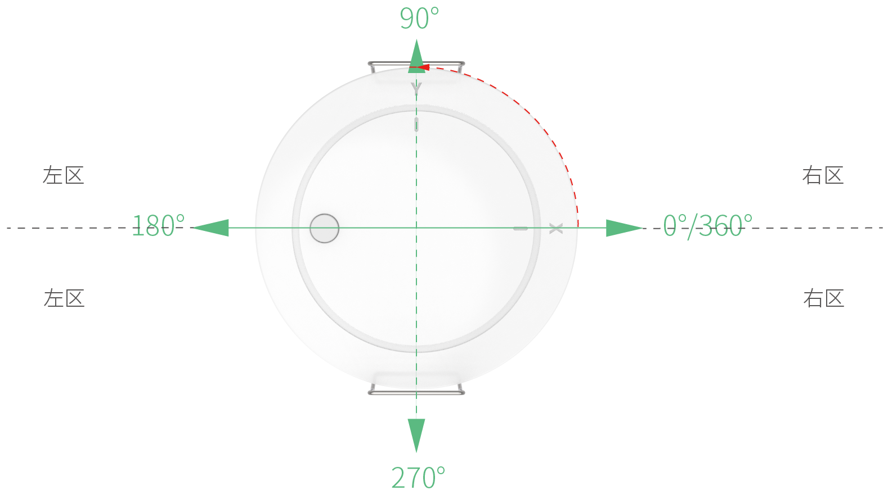

:::note 测试条件
性能曲线在室内环境（5m×5m）、安装高度 3m、X/Y 坐标范围 ±300cm 条件下测得；以上性能曲线仅供参考，具体以实际产品实测为准。
:::

### 1.6 可定制项

| 定制项 | 定制范围 | 单位 | 说明 |
|--------|---------|------|------|
| 发射功率 | 12/14/15/16 | dBm | 可配置 |
| 存在检测半径 | 3 Max | m | 最大存在检测半径 |
| 跌倒检测半径 | 3 Max | m | 最大跌倒检测半径 |
| 推荐安装高度 | 2.5-3.5（默认 3.0） | m | 与安装环境一致 |
| 运动灵敏度 | 1-10（默认 10） | 级 | 数值越高越灵敏 |
| 存在灵敏度 | 1-10（默认 10） | 级 | 数值越高越灵敏 |
| 延时时间 | 1-65535（默认 30） | s | 人员离开后按设定延时上报无人 |
| 检测区域（X/Y/Z） | X/Y：±3000；Z：0-3500 | mm | 感应区坐标边界可自定义 |
| 状态上报周期 | 500-65535 | ms | 雷达上报周期 |
| 输出格式 | 可配置 | - | 协议输出格式可配置 |
| 通讯参数 | RS485 / KNX / 涂鸦 Zigbee、透传等 | - | 按项目系统环境配置 |

:::note
如有未标明的其他定制需求，请联系销售经理或 FAE 进行评估。
:::

## 2 命名规范

| 字段 | 取值 | 含义 |
|------|------|------|
| 制造商 | ED | 易探 EasyDetek |
| 频段 | V | 60GHz |
| 大类别 | 2 | 独立传感器 |
| 子类别 | 5 | 通用 |
| 编号 | P | 产品编号 |
| 扩展功能 | 4 / K / T | 4＝RS485、K＝KNX、T＝涂鸦 |
| 流水号 | 0~9、A~Z | 流水号 |

**示例**：EDV25P-4 = 易探（ED）+ 60GHz 频段（V）+ 独立传感器（2）+ 通用（5）+ 产品编号（P）+ RS485 功能（4）；EDV25P-K 中 K 代表 KNX，EDV25P-T 中 T 代表涂鸦。

各字段可选代号含义：

| 字段 | 可选代号 |
|------|---------|
| 频段 | C＝5.8GHz、X＝10.5GHz、Q＝24GHz、V＝60GHz、S＝生态产品 |
| 大类别 | 1＝雷达模组、2＝独立传感器、3＝天线＆器件、4＝MCU、5＝配件、6＝IC、7＝AI 传感、8＝组网、9＝待定义 |
| 子类别 | 0＝超低功耗、1＝旗舰、2＝侧装、3＝外置可调、5＝通用、6＝户外、7＝保留、8＝基础、9＝高空 |
| 扩展功能 | Y＝有光敏、N＝无光敏、A＝Matter、B＝BLE、C＝Casambi、D＝Dali、G＝干接点、K＝KNX、M＝米家、P＝PLC、R＝RF433、S＝AC 开关、T＝涂鸦、W＝WiFi、Z＝Zigbee、1＝Cat-1、2＝2.4G、4＝RS485 |

## 3 使用指南

### 3.1 安装指南

#### 安装前检查

- 确认安装环境符合要求，避免周边有震动源（冰箱、空调外机、水泵等）
- 检查感应范围内无晃动物体、大面积金属物品（吊灯、风扇、金属涂层镜子等）
- 确认供电电源纹波低于 100mV，避免电源干扰
- 如与其他雷达传感器同场使用，确保安装间距大于 2 米

#### 安装步骤

- 安装高度：推荐 2.5-3.5 米（默认 3 米），存在检测半径最大 3 米，跌倒检测半径最大 3 米
- 嵌入式暗装：开设 Φ55mm 标准安装孔，提前布设供电/通讯线缆

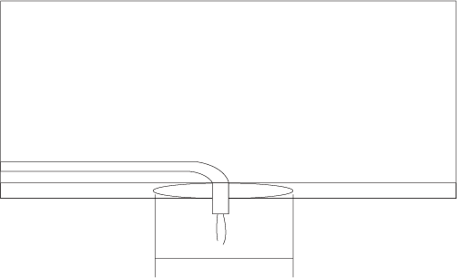

- 接线操作：按照对应型号接口定义，连接电源线、通讯线，确认接线牢固

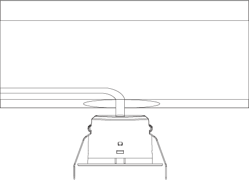

- 卡扣调节：调整设备两侧安装卡扣，适配吊顶厚度

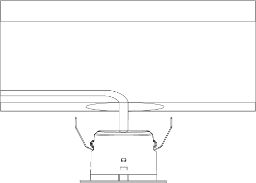

- 固定就位：将设备嵌入开孔，保持设备稳固，避免抖动，锁紧卡扣，完成安装

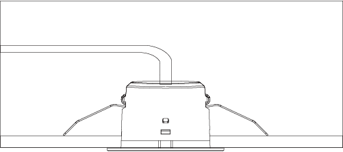

#### 接线说明

**EDV25P-4（RS485 版）**：DC 12-30V 供电（V/G 端子），RS485 通讯接 RS485-A / RS485-B 端子，接主站（PLC/中控系统）时注意 RS485-A / RS485-B 极性对应。

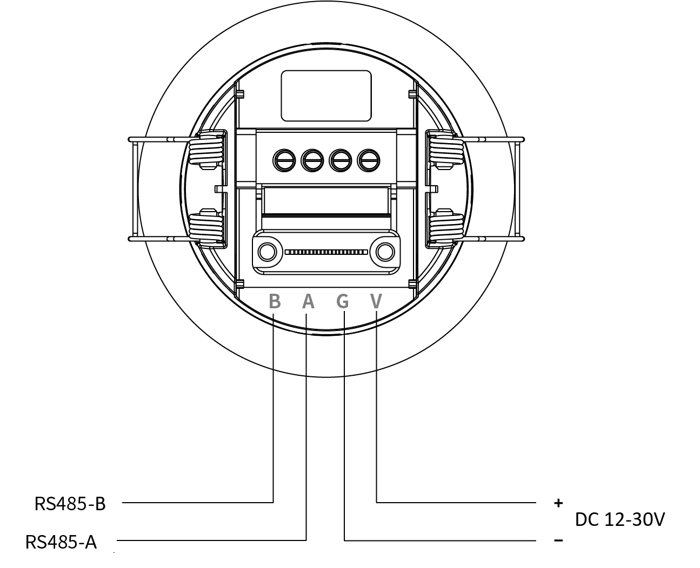

**EDV25P-K（KNX 版）**：DC 12-30V 供电（VCC/GND 端子），KNX+、KNX- 端子对接 KNX 系统专用通讯线路，注意极性对应。

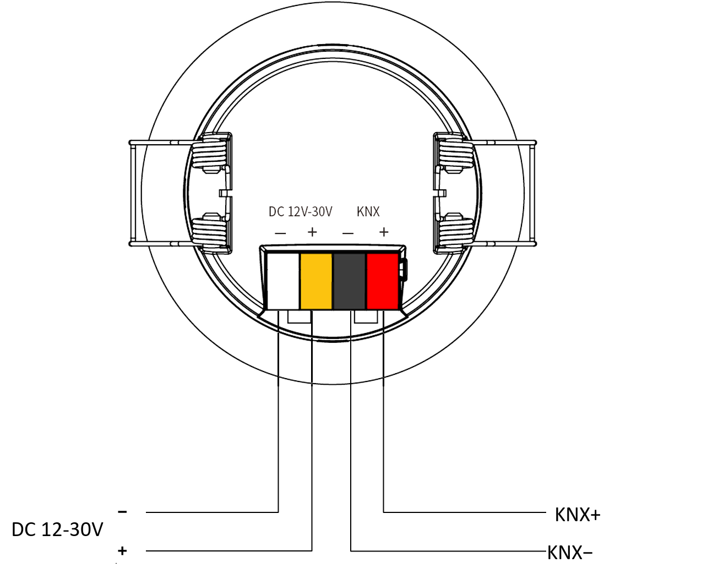

**EDV25P-T（涂鸦 Zigbee 版）**：火线（L）与零线（N）接入 AC 90-277V 市电供电，接线时请断电操作。接线端子为 L / N / L / N 排列，如采用手拉手方式布线，可将另外的 L / N 端子供给其他设备。

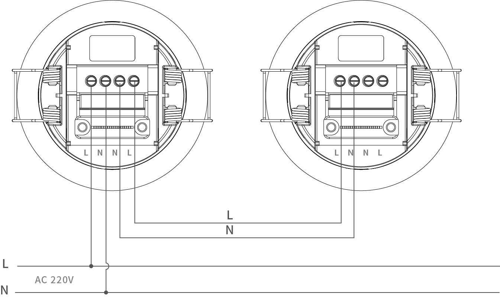

### 3.2 功能时序

全系列统一指示灯与功能时序：

| 序号 | 工作状态 | 指示灯说明 |
|------|---------|-----------|
| 1 | 开机上电 | 绿色指示灯常亮 5 秒 |
| 2 | 正常运行 | 检测到有人时，绿色指示灯每 10 秒闪烁 1 次 |
| 3 | 进入配网模式 | 长按配网键 5 秒后，1 秒闪 4 次进入配网模式 |
| 4 | 配网中 | 配网过程中每 3 秒闪烁 1 次 |
| 5 | 监测到人员跌倒 | 检测到跌倒事件时，绿色指示灯常亮 3 秒 |

:::note
长按按键 10 秒恢复出厂设置（参数恢复默认，涂鸦版本场景绑定保留）。
:::

### 3.3 设置和调试指南

#### 初始化与自学习

设备首次安装、更换安装环境后，建议断电重启一次，设备自动完成环境自学习，过滤墙体、固定家具等静态干扰，保障跌倒检测、存在检测的准确性；修改安装高度、检测区域等参数后，保存配置等待 10 秒算法生效，再现场测试检测效果。

### 3.4 小程序使用指南

#### 连接准备

- 设备正常上电，开启手机蓝牙与定位，搜索对应设备蓝牙名称完成连接
- 进入 EDV25P 设备控制主界面，查看设备基础信息

#### 主界面功能

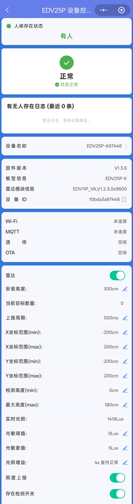

人体存在状态显示：小程序首页显示人体存在状态，能直观区分「有人/无人」，用于快速判断当前检测区域内是否存在人员。

跌倒状态显示：小程序状态页显示跌倒状态（正常/疑似/确认），检测到跌倒事件时即时告警提示。

小程序主界面可见的主要功能项：

- **设备信息显示**：设备名称、固件版本、板型信息、雷达模块信息、设备 ID，便于售后与调试确认
- **工作及连接状态显示**：Wi-Fi、MQTT、透传、OTA 等运行信息
- **有无人存在日志**：记录并展示有人/无人状态推送记录
- **雷达开关 / 存在检测开关**：开启或关闭雷达检测与存在检测功能
- **安装高度设置**：按实际安装高度设置（图示为 300cm）
- **当前目标数量、上报周期**：查看实时目标数量与数据上报周期（图示为 500ms）
- **检测范围设置**：X / Y 坐标范围最小值与最大值、检测高度最小值与最大高度
- **光照相关设置**：实时光照读数（Lux）、光敏阈值、光敏差值、光照增益，以及照度上报开关

:::note
界面参数以设备实际页面为准，图示数值仅供参考。
:::

#### 注意事项

- 参数修改后建议同步保存配置，避免断电丢失
- 蓝牙连接距离建议控制在 5 米以内，障碍物过多会导致连接不稳定
- 安装高度需与实际安装环境匹配，否则影响检测距离与灵敏度

## 4 协议规范

### 4.1 通信接口

| 接口类型 | EDV25P-4（RS485） | EDV25P-K（KNX） | EDV25P-T（涂鸦 Zigbee） | 功能说明 |
|---------|------------------|----------------|------------------------|---------|
| 蓝牙 BLE | √ | √ | √ | 小程序调试、参数配置 |
| UART 串口 | √ | √ | √ | 本地调试、数据透传 |
| RS485 总线 | √ | × | × | 工业/楼宇总线组网 |
| KNX 总线 | × | √ | × | KNX 楼宇总线专用 |
| 涂鸦 Zigbee 协议 | × | × | √ | 涂鸦 APP 联动 |

### 4.2 通讯协议

- **蓝牙协议**：私有蓝牙透传协议，供小程序配对、参数配置、实时数据查看
- **RS485 协议**：标准 Modbus 类总线协议，支持多设备组网、轮询读写状态与参数
- **KNX 协议**：兼容标准 KNX 楼宇协议，适配 KNX 智能家居/楼宇自动化系统
- **涂鸦 Zigbee 协议**：标准涂鸦 Zigbee 通讯协议，支持涂鸦 APP 配网、状态查看与参数配置

:::note
详细协议指令、寄存器地址、数据帧格式不在此文档中展开，请参考配套独立协议文档。
:::

:::caution MQTT 协议说明的适用型号待确认
本系列另有 [MQTT 协议说明](./mqtt-protocol) 文档，其网络层为 Wi-Fi STA，而本页 4.1 所列三个版本（EDV25P-4 / -K / -T）均不包含 Wi-Fi 版本，该文档与各版本的对应关系待产品团队确认，请勿据此推断适用型号。
:::

## 5 售后服务

### 5.1 安全合规

- 本产品符合室内智能传感设备安规标准，仅适用于室内环境使用
- 电气接线严格遵循国标电气规范，非专业人员禁止拆机、改线
- 设备防护等级 IP67，仅适用于常规室内防潮环境，禁止长期浸泡、户外淋雨使用

### 5.2 免责声明

- 因用户私自拆机、改装接线、违规供电造成的设备损坏、安全事故，本公司不承担保修及相关责任
- 未按照安装规范（间距、远离干扰源、避开金属区域）安装，导致设备误触发、检测异常，不在免费维保范围内
- 自然灾害、人为磕碰、外力损坏、进水进尘造成的故障，不予免费保修
- 产品固件、规格会持续迭代优化，更新版本不再单独通知，如需最新资料请联系销售人员
- 测试参数为实验室标准环境数据，实际使用效果因现场环境、安装方式存在差异，不属于产品质量问题

### 5.3 售后服务

- **质保服务**：产品按照行业标准提供质保，质保期内非人为质量问题可享受维修、更换服务
- **技术支持**：安装调试、参数配置、协议对接问题，可联系我司销售或 FAE 工程师提供技术支持
- **定制服务**：个性化功能、参数、接口定制，可对接商务团队评估方案与工期
- **资料获取**：最新版规格书、协议文档、固件程序，请联系官方工作人员索取

## 附录 A：系列清单

EDV25P 系列共三个版本，硬件平台相同（57.5-61.3GHz 毫米波雷达、内置数字光照传感器），区别在于供电方式与通讯协议：

| 型号 | 供电方式 | 通讯协议 | 说明 |
|------|---------|---------|------|
| EDV25P-4 | DC 12-30V | RS485 总线（标准 Modbus 类协议） | 工业/楼宇总线组网 |
| EDV25P-K | DC 12-30V | KNX 总线（标准 KNX 楼宇协议） | KNX 智能家居/楼宇自动化 |
| EDV25P-T | AC 90-277V | 涂鸦 Zigbee 协议 | 涂鸦 APP 联动 |

:::note
三版本共同特性：存在检测与跌倒检测半径最大 3m，推荐安装高度 2.5-3.5m（默认 3m）；蓝牙 BLE 与 UART 串口为三版本通用接口，支持小程序调试/参数配置、本地调试/数据透传；内置数字光照传感器，支持光照联动控制。型号命名规则详见第 2 章命名规范。
:::

## 附录 B：应用案例

源 PDF 附录 B 提供「B.1 案例 1」「B.2 案例 2」两个应用案例章节，正文以配图形式呈现；本在线版正文待补充，案例配图请查阅 [PDF 版说明书](./assets/EDV25P%E4%BD%BF%E7%94%A8%E8%AF%B4%E6%98%8E%E4%B9%A6-V1.0.0-20260915.pdf)。对应场景说明见「1.3 应用场景」。
