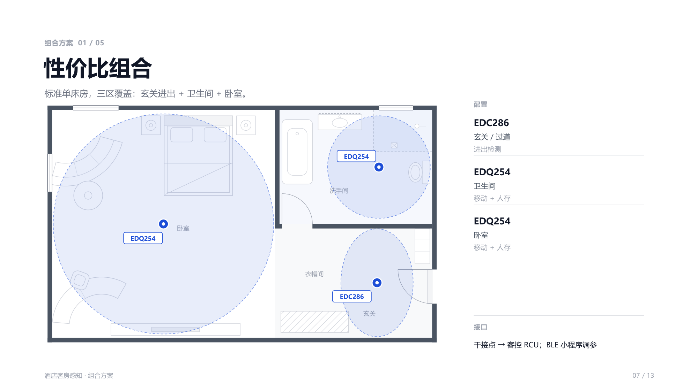
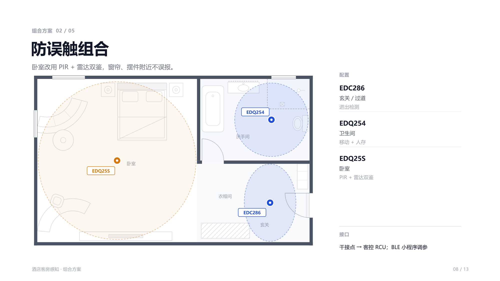
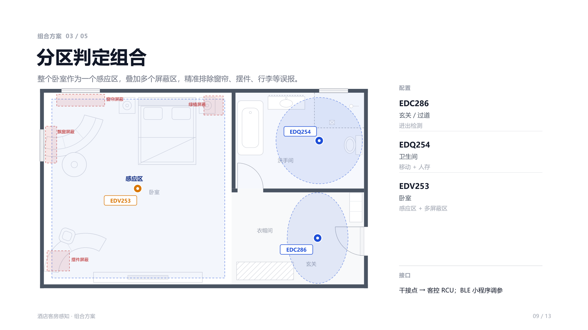
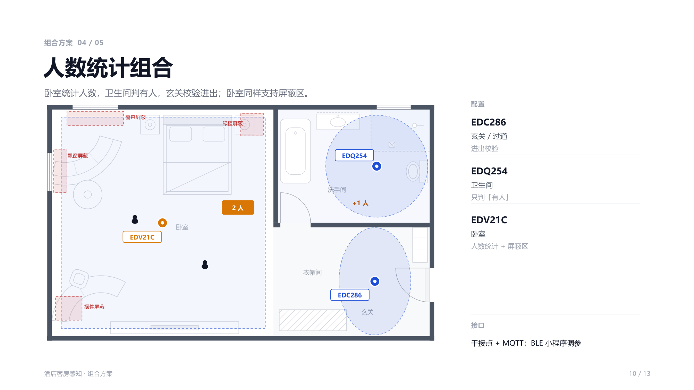
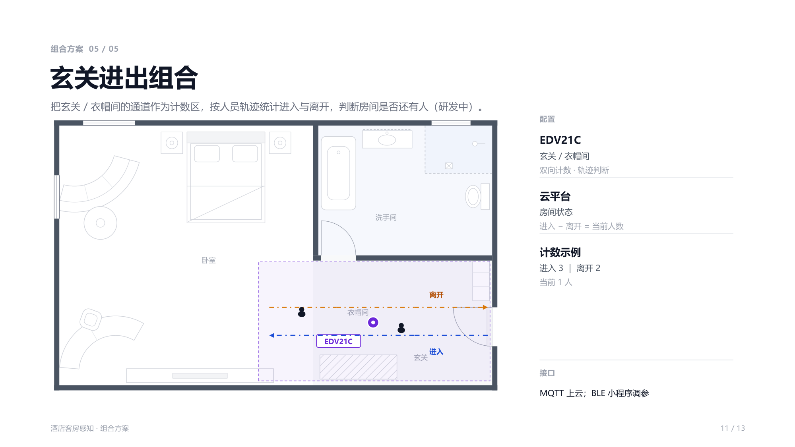

# 组合方案

同一个房型，按**预算**、**误报容忍度**、**是否需要人数**给出五种配置。所有方案均为「玄关 + 卫生间 + 卧室」三区覆盖，差别在卧室那一颗用哪款。

| 组合 | 卧室用 | 适合什么情况 | 需要客控 / 云平台做什么 |
|---|---|---|---|
| ① 性价比 | EDQ254 | 标准单床房，只要有人 / 无人 | 干接点读三路状态 |
| ② 防误触 | EDQ25S | 卧室靠近窗帘、摆件，怕误报 | 干接点读三路状态 |
| ③ 分区判定 | EDV253 | 需要按空间几何排除窗帘 / 飘窗 / 行李 | 干接点 + BLE 调屏蔽区 |
| ④ 人数统计 | EDV21C | 要知道房间里有几个人 | 干接点 + MQTT |
| ⑤ 玄关进出 | EDV21C（玄关） | 按轨迹判断房间是否还有人 | MQTT 上云 |

---

## ① 性价比组合

标准单床房，三区覆盖：**玄关进出 + 卫生间 + 卧室**。

| 点位 | 型号 | 作用 |
|---|---|---|
| 玄关 / 过道 | EDC286 | 进出检测 |
| 卫生间 | EDQ254 | 移动 + 人存 |
| 卧室 | EDQ254 | 移动 + 人存 |

**接口**：干接点 → 客控 RCU；BLE 小程序调参。

**为什么这样配**：三颗都是「有人 / 无人」型输出，客控侧只要能读干接点即可，是改造成本最低的一版；卫生间与卧室用同一款，备件与调参口径统一。

---

## ② 防误触组合

卧室改用 **PIR + 雷达双鉴**，窗帘、摆件附近不误报。

| 点位 | 型号 | 作用 |
|---|---|---|
| 玄关 / 过道 | EDC286 | 进出检测 |
| 卫生间 | EDQ254 | 移动 + 人存 |
| 卧室 | EDQ25S | PIR + 雷达双鉴 |

**接口**：干接点 → 客控 RCU；BLE 小程序调参。

**为什么这样配**：把卧室这一颗换成双鉴，等于给「移动即有人」加了一道 PIR 复核。代价是响应更保守，适合入住率高、投诉敏感的项目。

---

## ③ 分区判定组合

整个卧室作为一个**感应区**，叠加多个**屏蔽区**，精准排除窗帘、摆件、行李等误报。

| 点位 | 型号 | 作用 |
|---|---|---|
| 玄关 / 过道 | EDC286 | 进出检测 |
| 卫生间 | EDQ254 | 移动 + 人存 |
| 卧室 | EDV253 | 感应区 + 多屏蔽区 |

典型屏蔽对象：**窗帘、飘窗、绿植、摆件**。

**接口**：干接点 → 客控 RCU；BLE 小程序调参。

**为什么这样配**：双鉴靠「两颗传感器投票」，EDV253 靠「空间几何划界」。房间形状不规则、干扰源位置固定时，屏蔽区比双鉴更精准，而且后期可现场改。

---

## ④ 人数统计组合

卧室统计人数，卫生间判有人，玄关校验进出；卧室同样支持屏蔽区。

| 点位 | 型号 | 作用 |
|---|---|---|
| 玄关 / 过道 | EDC286 | 进出校验 |
| 卫生间 | EDQ254 | 只判「有人」 |
| 卧室 | EDV21C | 人数统计 + 屏蔽区 |

**接口**：干接点 + MQTT；BLE 小程序调参。

**为什么这样配**：只有这一版能回答「几个人」。人数可用于节能策略的强度分级、保洁调度与异常留宿识别；卫生间仍然只需要「有人 / 无人」，没有必要上 4T4R。

---

## ⑤ 玄关进出组合（研发中）

把玄关 / 衣帽间的通道作为**计数区**，按人员轨迹统计进入与离开，判断房间是否还有人。

| 点位 | 型号 | 作用 |
|---|---|---|
| 玄关 / 衣帽间 | EDV21C | 双向计数 · 轨迹判断 |
| 云平台 | — | 房间状态 |

计数逻辑：**进入 − 离开 = 当前人数**（示例：进入 3、离开 2 → 当前 1 人）。

**接口**：MQTT 上云；BLE 小程序调参。

:::warning 研发中
玄关双向进出计数目前仍在研发阶段，**不纳入对外承诺**；招投标与技术协议中请按「规划能力」处理，或改用组合 ④ 的人数统计实现近似效果。
:::

---

## 相关文档

- [核心产品](./products.md)：五款型号的规格与分工
- [接口与接入](./interfaces.md)：干接点 / KNX / RS485 / MQTT 的接口矩阵
