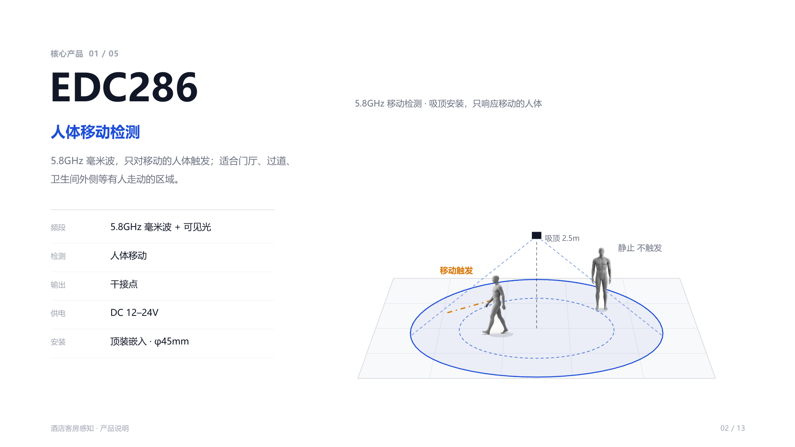
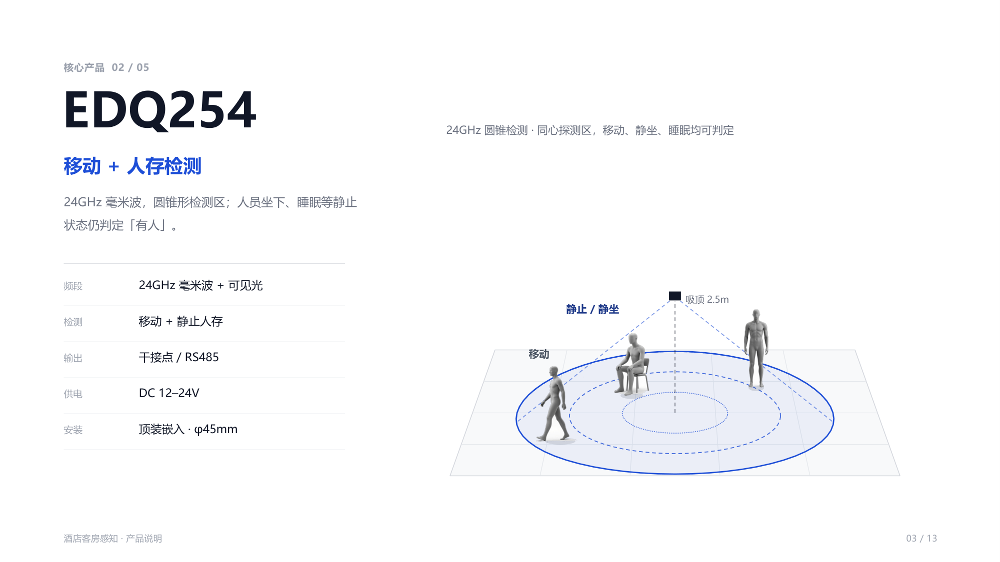
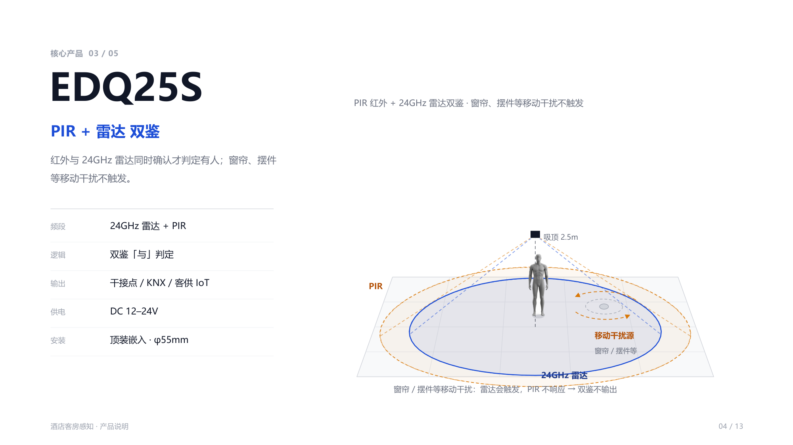
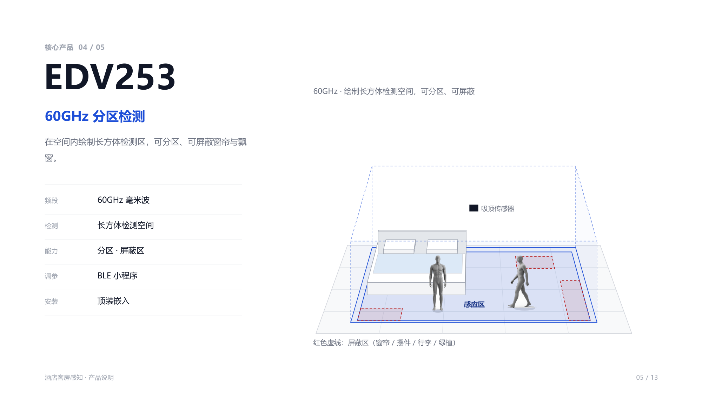
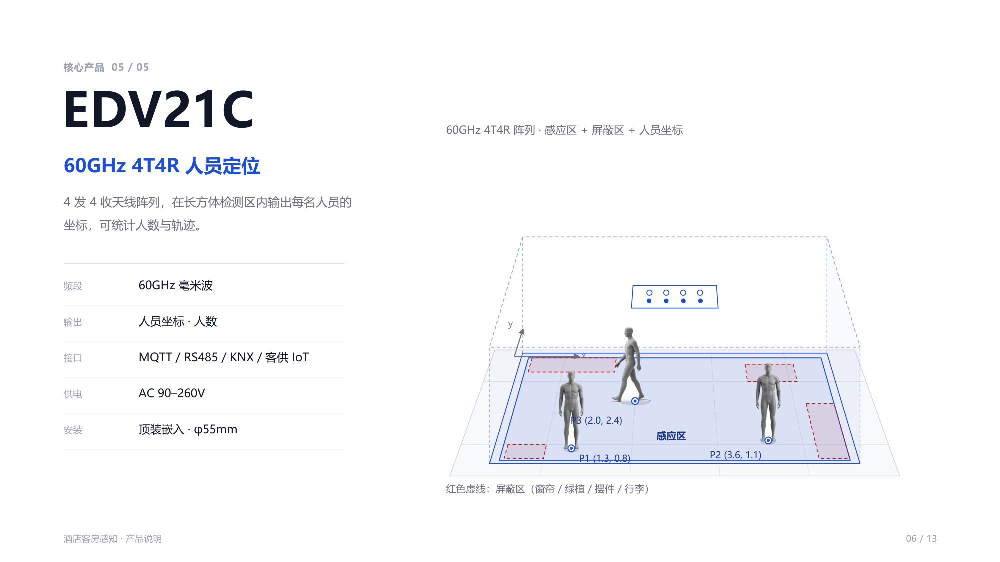

# 核心产品

五款型号覆盖同一间客房里的不同粒度：**只看移动**（EDC286）→ **移动 + 静止人存**（EDQ254）→ **双鉴抗误报**（EDQ25S）→ **分区 + 屏蔽区**（EDV253）→ **人员坐标与人数**（EDV21C）。

> 本页参数取自《酒店客房感知方案》产品说明册（v2）。完整电气参数、认证与订购信息以**最新规格书**为准；EDQ254、EDV253 目前暂无独立单品页。

## 选型对照

| 型号 | 频段 | 检测能力 | 输出 / 接口 | 供电 | 安装开孔 |
|---|---|---|---|---|---|
| EDC286 | 5.8GHz + 可见光 | 人体移动 | 干接点 | DC 12–24V | 顶装嵌入 · φ45mm |
| EDQ254 | 24GHz + 可见光 | 移动 + 静止人存 | 干接点 / RS485 | DC 12–24V | 顶装嵌入 · φ45mm |
| EDQ25S | 24GHz + PIR | 双鉴「与」判定 | 干接点 / KNX / 客供 IoT | DC 12–24V | 顶装嵌入 · φ55mm |
| EDV253 | 60GHz | 长方体检测空间 · 分区 · 屏蔽区 | 见[接口与接入](./interfaces.md) | 以规格书为准 | 顶装嵌入 |
| EDV21C | 60GHz | 人员坐标 · 人数 | MQTT / RS485 / KNX / 客供 IoT | AC 90–260V | 顶装嵌入 · φ55mm |

---

## EDC286 · 人体移动检测

5.8GHz 毫米波，**只对移动的人体触发**；适合门厅、过道、卫生间外侧等有人走动的区域。

| 参数 | 规格 |
|---|---|
| 频段 | 5.8GHz 毫米波 + 可见光 |
| 检测 | 人体移动 |
| 输出 | 干接点 |
| 供电 | DC 12–24V |
| 安装 | 顶装嵌入 · φ45mm |

**在本方案里的用法**：装在玄关 / 过道做进出检测。因为只响应移动，它天生不会把「客人躺着」当成信号，适合只关心「有没有人走过」的位置；需要静止人存的位置请换 EDQ254。

---

## EDQ254 · 移动 + 人存检测

24GHz 毫米波，**圆锥形检测区**；人员坐下、睡眠等静止状态仍判定「有人」。

| 参数 | 规格 |
|---|---|
| 频段 | 24GHz 毫米波 + 可见光 |
| 检测 | 移动 + 静止人存 |
| 输出 | 干接点 / RS485 |
| 供电 | DC 12–24V |
| 安装 | 顶装嵌入 · φ45mm |

**在本方案里的用法**：卫生间与卧室的默认选择——移动与静坐/睡眠都能判定，是「性价比组合」的主力。站内同平台型号见 [EDQ286B（新命名 EDQ254-G-01）](/sensors/BLE%E8%93%9D%E7%89%99/edq286b)。

---

## EDQ25S · PIR + 雷达双鉴

红外与 24GHz 雷达**同时确认**才判定有人；窗帘、摆件等移动干扰不触发。

| 参数 | 规格 |
|---|---|
| 频段 | 24GHz 雷达 + PIR |
| 逻辑 | 双鉴「与」判定 |
| 输出 | 干接点 / KNX / 客供 IoT |
| 供电 | DC 12–24V |
| 安装 | 顶装嵌入 · φ55mm |

**在本方案里的用法**：卧室靠近窗帘、摆件时替换 EDQ254。双鉴的代价是响应更保守——雷达会因窗帘触发，但 PIR 不响应，因此**不输出**，这正是要的效果。

站内现有版本：[EDQ25S-G-01（BLE）](/sensors/BLE%E8%93%9D%E7%89%99/edq25s-g-01)、[EDQ25S-M（AC 强电 / 米家）](/sensors/AC%E5%BC%BA%E7%94%B5/edq25s-m)。

---

## EDV253 · 60GHz 分区检测

在空间内**绘制长方体检测区**，可分区、可屏蔽窗帘与飘窗。

| 参数 | 规格 |
|---|---|
| 频段 | 60GHz 毫米波 |
| 检测 | 长方体检测空间 |
| 能力 | 分区 · 屏蔽区 |
| 调参 | BLE 小程序 |
| 安装 | 顶装嵌入 |

**在本方案里的用法**：把整个卧室作为一个感应区，再叠加多个**屏蔽区**排除窗帘、飘窗、绿植、摆件、行李。相比双鉴，它靠空间几何而不是双传感器投票来抗误报，屏蔽区位置可现场调整。

---

## EDV21C · 60GHz 4T4R 人员定位

4 发 4 收天线阵列，在长方体检测区内输出**每名人员的坐标**，可统计人数与轨迹。

| 参数 | 规格 |
|---|---|
| 频段 | 60GHz 毫米波 |
| 输出 | 人员坐标 · 人数 |
| 接口 | MQTT / RS485 / KNX / 客供 IoT |
| 供电 | AC 90–260V |
| 安装 | 顶装嵌入 · φ55mm |

**在本方案里的用法**：人数统计（卧室）与玄关双向计数。输出的是坐标而非「有人 / 无人」，所以能回答「几个人」；坐标原点与单位以现场标定为准。

站内另有[60GHz 康养监护版](/sensors/60GHz%E5%BA%B7%E5%85%BB/edv21c/)（跌倒检测 / 呼吸心率），同一硬件、不同应用口径。

---

## 相关文档

- [组合方案](./combinations.md)：五种房间配置的具体搭配
- [接口与接入](./interfaces.md)：各型号支持的接口与接入客控的路径
